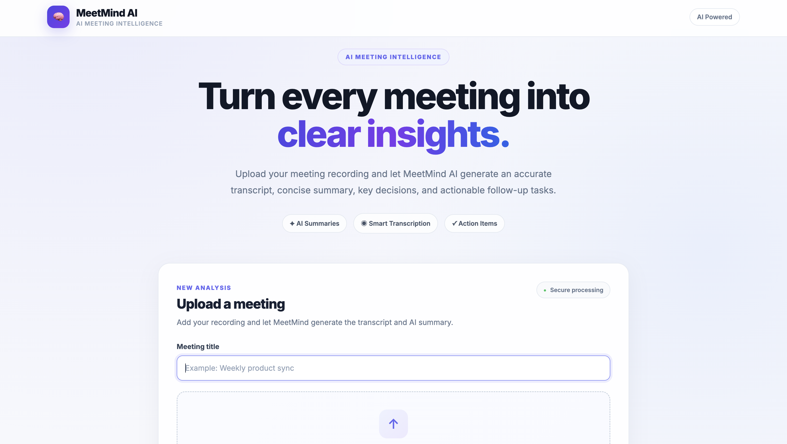
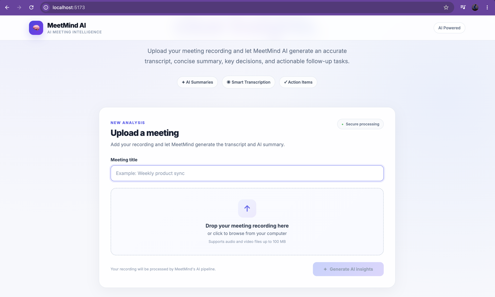
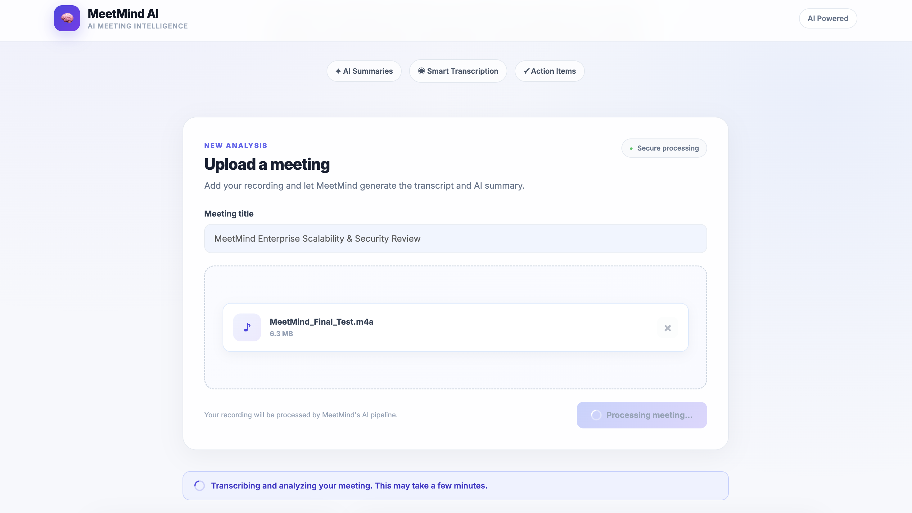
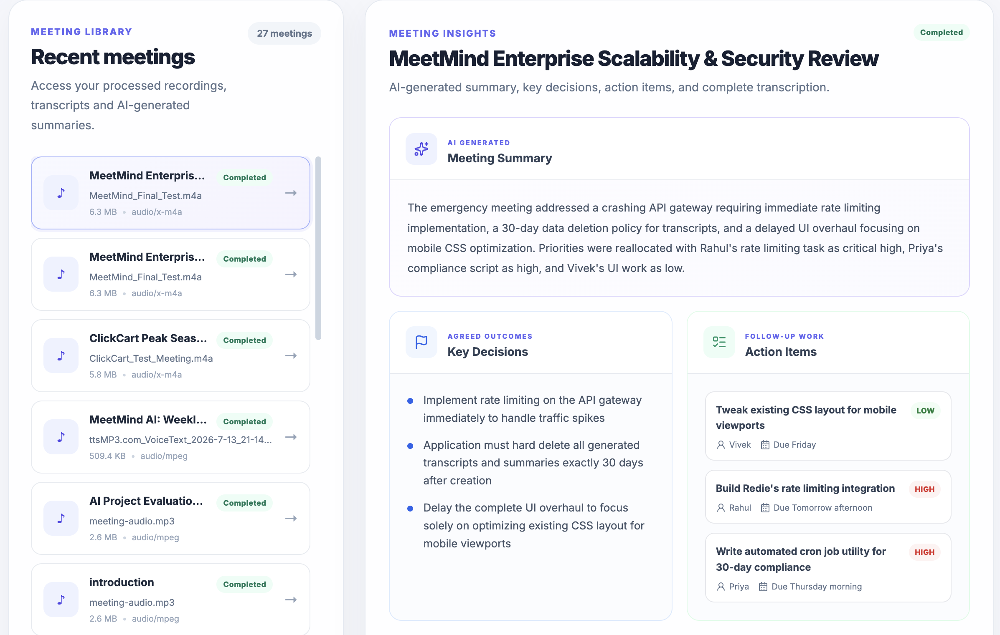
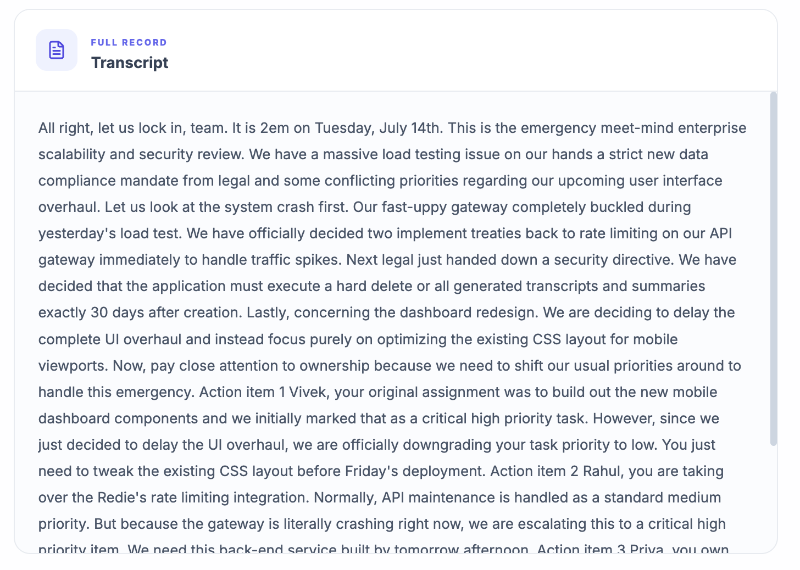

# 🧠 MeetMind AI

AI-powered meeting intelligence platform that converts meeting recordings into structured insights using speech-to-text and Large Language Models.

---
## 🚀 Features

- 🎙 Upload audio/video meetings
- 📝 Automatic speech-to-text transcription
- 📄 AI-generated meeting summary
- ✅ Key decision extraction
- 📌 Action item generation
- 👥 Owner assignment
- ⏰ Due date extraction
- 🔥 Priority detection
- 📚 Meeting history
- 🎨 Modern React UI

---
## 🛠 Tech Stack

### Frontend
- React.js
- CSS3
- Axios

### Backend
- Spring Boot
- Java

### AI Service
- Python
- Faster-Whisper
- Qwen3 LLM

---
## 🏗 Architecture

```
Frontend (React)
        │
        ▼
Spring Boot Backend
        │
        ▼
Python AI Service
        │
        ├── Faster Whisper
        └── Qwen3 LLM
```

---
## 📁 Project Structure

```
Meetmind-ai
│
├── frontend
├── backend
├── ai-service
├── docs
├── screenshots
└── README.md
```

---
## 🤖 AI Workflow

1. Upload meeting recording
2. Convert speech to text using Faster-Whisper
3. Generate AI summary using Qwen3
4. Extract key decisions
5. Extract action items
6. Identify owners
7. Detect priorities
8. Extract due dates
9. Display results in the dashboard

---
## 📸 Screenshots

### 🏠 Home Page (Top)



---

### 🏠 Home Page (Workspace)



---

### ⚙️ AI Processing



---

### 📊 AI Generated Insights



---

### 📜 Transcript



---
## ⚙️ Installation

### 1. Clone the Repository

```bash
git clone https://github.com/vivekjogdand22/Meetmind-ai.git
cd Meetmind-ai
```

### 2. Start the Backend

```bash
cd backend
./mvnw spring-boot:run
```

The Spring Boot backend will start on:

```
http://localhost:8080
```

---

### 3. Start the AI Service

Open a new terminal.

```bash
cd ai-service
source venv/bin/activate
python main.py
```

The AI service will start on:

```
http://localhost:8000
```

---

### 4. Start the Frontend

Open another terminal.

```bash
cd frontend
npm install
npm run dev
```

The React application will start on:

```
http://localhost:5173
```

---

### 5. Open the Application

Open your browser and visit:

```
http://localhost:5173
```

Upload an audio or video meeting and MeetMind AI will automatically:

- 🎙 Transcribe the recording
- 📝 Generate an AI summary
- ✅ Extract key decisions
- 📌 Generate action items
- 👤 Assign owners
- ⏰ Detect due dates
- 🔥 Detect priorities

---
## 🚀 Future Improvements

The following enhancements are planned for future versions of MeetMind AI:

- 🔍 Search meetings by title or keyword
- 🗑 Delete meetings from history
- 📄 Export meeting summary as PDF
- 📑 Export transcript as DOCX
- 📊 Meeting analytics dashboard
- 👥 Speaker identification
- 🔐 User authentication and authorization
- ☁ Cloud deployment (AWS/Azure/GCP)
- 📱 Responsive mobile-first interface
- 🌍 Multi-language transcription and translation
- 🔔 Email notifications for action items
- 📅 Calendar integration (Google Calendar / Outlook)
- 📈 Team productivity insights
- 🤖 Support for additional AI models
- ⚡ Real-time meeting transcription

---
## 👨‍💻 Developed By

**Vivek Jogdand**

Computer Engineering Student

### Technologies Used

- React.js
- Spring Boot
- Python
- Faster-Whisper
- Qwen3
- REST API

---

⭐ If you found this project interesting, consider giving it a star on GitHub.